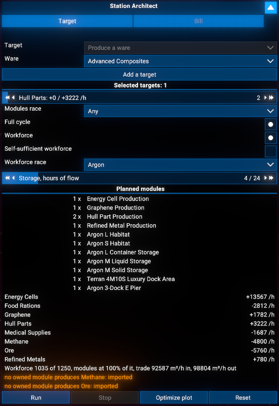
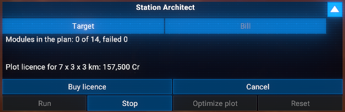
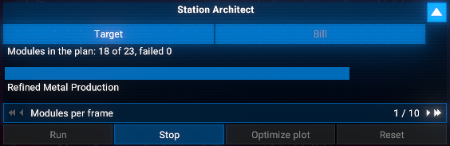
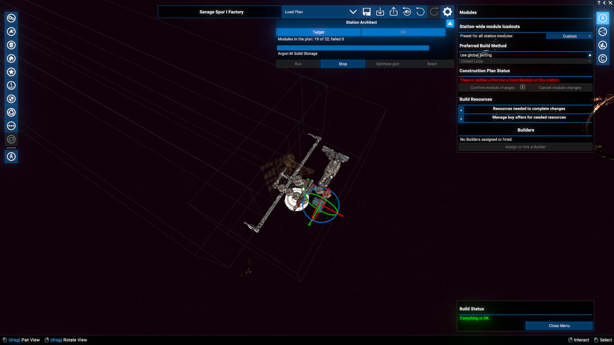
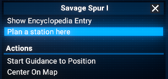
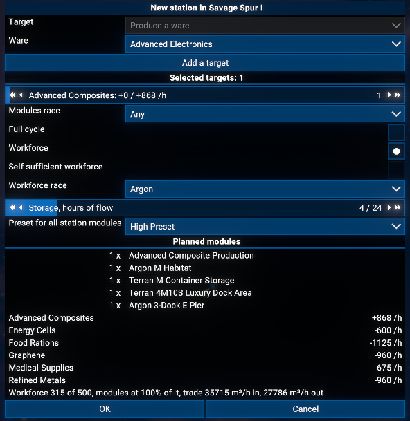
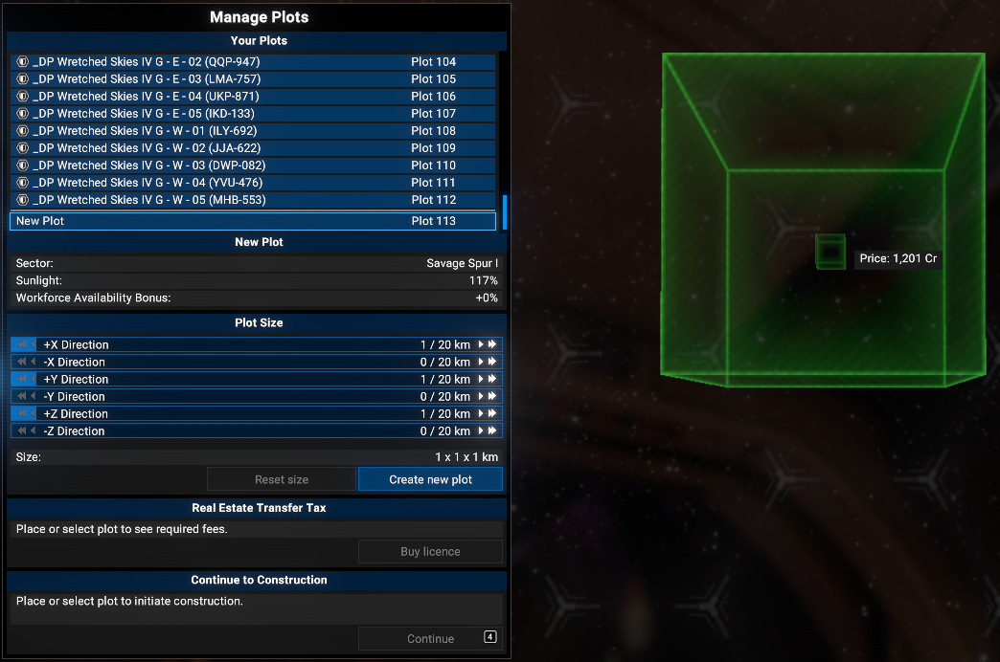
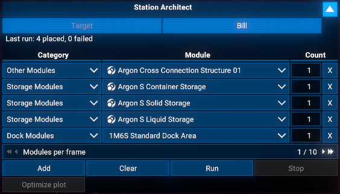

# Station Architect

Tell the build menu what your station should produce or build: this extension works out every module needed and places them as one compact block. Nothing is bought until you press **Confirm**.

## Features

- **Target planner**: say what the station should make (a ware, or ships to build or repair), not which modules; several targets in one plan.
- **Compact layout**: production, storage and habitats packed tight on connection modules; build modules on the sides with clear approach lanes; docks and piers outward.
- **Full cycle and workforce**: optionally every intermediate ware down to raw resources and energy, habitats for the workforce, and its food and medicine.
- **Read from the game**: production rates, sunlight and workforce bonuses, module sizes, docking bays and ship build times; docks sized for the planned traffic.
- **Preview first**: modules, each ware's balance per hour, workforce and warnings before anything is placed.
- **Existing stations**: reads what a station makes and fills any shortfall.
- **From the map**: right-click empty space, **Plan a station here**, and the build menu opens with the run started.
- **Bill route**: a manual list of modules and counts, placed the same way.
- **Plot licence**: shows the plot size and price where the plot costs money; **Optimize plot** shrinks it afterwards.
- **The plan stays yours**: edit, save or load it by hand; **Confirm module changes** pays as usual, **Cancel module changes** discards it.

## Limitations

- Works only inside the open build menu of a station you own, with your own blueprints.
- This mod requires `Protected UI Mode` in the game's Extensions settings to be disabled.
- Windows version of the game only: the placement route reads the game's own editor in memory, which the native Linux build does not expose the same way. The Windows game running on Linux through Proton or Wine should work.
- Verified on the 8.00 and 9.00 builds of the game. On a build it does not recognise, the panel says the editor is not reachable and Run stays off; nothing else in the build menu changes.
- The plot is limited to the game's 20 km: a layout that needs more is refused before anything is placed.
- Ship build times assume the station has its build drones; a shipyard without them builds several times slower than planned.
- A module that fits nowhere is reported as failed, never silently dropped.

## Requirements

- **X4: Foundations**: Version **8.00** or higher, Windows version.
- **Mod Support APIs**: Version **1.95** or higher by [SirNukes](https://next.nexusmods.com/profile/sirnukes?gameId=2659).
  - Available on Steam: [SirNukes Mod Support APIs](https://steamcommunity.com/sharedfiles/filedetails/?id=2042901274)
  - Available on Nexus Mods: [Mod Support APIs](https://www.nexusmods.com/x4foundations/mods/503)
- **Options Helper**: Version **1.10** or higher by [Chem O`Dun](https://next.nexusmods.com/profile/ChemODun/mods?gameId=2659).
  - Available on Steam: [Options Helper](https://steamcommunity.com/sharedfiles/filedetails/?id=3715253556)
  - Available on Nexus Mods: [Options Helper](https://www.nexusmods.com/x4foundations/mods/2155)
- **Print Extension List**: Version **1.00** or higher by [Chem O`Dun](https://next.nexusmods.com/profile/ChemODun/mods?gameId=2659).
  - Available on Steam: [Print Extension List](https://steamcommunity.com/sharedfiles/filedetails/?id=3770927339)
  - Available on Nexus Mods: [Print Extension List](https://www.nexusmods.com/x4foundations/mods/2191)
- **Lua Log API**: Version **1.00** or higher by [Chem O`Dun](https://next.nexusmods.com/profile/ChemODun/mods?gameId=2659).
  - Available on Steam: [Lua Log API](https://steamcommunity.com/sharedfiles/filedetails/?id=3823580916)
  - Available on Nexus Mods: [Lua Log API](https://www.nexusmods.com/x4foundations/mods/2473)
- **Extra Data API**: Version **1.00** or higher by [Chem O`Dun](https://next.nexusmods.com/profile/ChemODun/mods?gameId=2659).
  - Available on Steam: [Extra Data API](https://steamcommunity.com/sharedfiles/filedetails/?id=3825599643)
  - Available on Nexus Mods: [Extra Data API](https://www.nexusmods.com/x4foundations/mods/2519)

## Installation

You can download the latest version via Steam client - [Station Architect](https://steamcommunity.com/sharedfiles/filedetails/?id=3827769999)
Or you can do it via the Nexus Mods - [Station Architect](https://www.nexusmods.com/x4foundations/mods/2520)

## Save state

**No** (removing the extension does not break saves).

## Usage

Open the build menu of one of your stations. The Station Architect panel sits under the menu's title bar; expand it to plan. It has two tabs: **Target** and **Bill**.

### Target

1. Pick the kind of target (**Produce a ware** or **Build or maintain ships**), then the ware or the build module, and press **Add a target**. Each added target gets a slider for its number of production or build modules; on an existing station a slider starts at what the station already has, and releasing it at that lowest value removes the target.
   **Special resource modules** (Scrap Processors, fed by tugs rather than by trade): pick one and press **Add a module**; its slider sets how many the station has. With **Full cycle** their scrap metal feeds scrap recycling modules that make your target wares, and only the rest comes from regular production modules (a surplus is sold); without it the scrap metal is sold. Tugs bring their raw scrap straight to them, so it adds no docks, piers or storage.
2. Set the options: **Modules race**, **Full cycle**, **Workforce**, **Self-sufficient workforce**, **Workforce race** and **Storage, hours of flow** (how many hours of each ware's flow the storage holds).
3. Check the preview: the planned modules, each ware's net per hour now and planned, the workforce and trade line, and any warning.

4. Press **Run**. The run first finds a layout. Where the plot costs money, it then shows the plot size it needs and the licence price, and places nothing until you press **Buy licence**; **Cancel** ends the run.

5. The run places the modules one after another; the panel shows the progress, and **Stop** halts it after the current module. The menu's lists are rebuilt once when the run ends, not after every module.

6. When the run ends the panel folds to its result (placed, failed). Check the plan, change what you like by hand, and press **Confirm module changes** as usual. **Optimize plot** fits the plot to the planned modules, so a plot the run grew is not paid larger than needed. **Reset** starts the target over from what the station has.

### From the map

Right-click empty space in a sector on the map and choose **Plan a station here**.

The dialog shows the same target form, plus **Preset for all station modules** (the loadout of the new modules).

OK closes the dialog and puts the game's own plot box on your cursor, as the Plots tab's **Create plot** does: the box turns red where a plot may not go, and a left click reserves it. A right click or Escape before that click cancels the plan.

The build menu then opens and the run starts. The plot starts at 1 km and grows with the modules; **Confirm module changes** stays your click.

### Bill

The manual route: pick a category and a module from your blueprints, set the count, press **Add**. Repeat for every module type; a row's X removes it, **Clear** empties the bill.

**Run** places the modules on the station's free connections, nearest to the centre first, docks, piers, build and defence modules on outward connections. Connection modules in the bill are not placed as such: they are the budget of connectors the run may insert when a module finds no free connection.

## Options

In the game's Extension Options, the Station Architect page has a Debug Level setting (None, Debug, Trace) for the game log.

## Videos

- [Intro video](https://www.youtube.com/watch?v=I0ORUjMGBjQ)

## Credits

- Author: Chem O`Dun, on [Nexus Mods](https://next.nexusmods.com/profile/ChemODun/mods?gameId=2659) and [Steam Workshop](https://steamcommunity.com/id/chemodun/myworkshopfiles/?appid=392160)
- *"X4: Foundations"* is a trademark of [Egosoft](https://www.egosoft.com).

## Acknowledgements

- [EGOSOFT](https://www.egosoft.com) for the X series.
- [SirNukes](https://next.nexusmods.com/profile/sirnukes?gameId=2659) for the Mod Support APIs that power the UI hooks.

## Changelog

### [1.11] - 2026-11-??

- Changed
  - Placement order, turn by turn from the bottom up, so the station works after its first turn and each turn adds output: docks and piers first, then storage and the production chain from energy up, the final product last
  - Habitats and the modules that only feed them come after 40 % of the turns, spread evenly over the rest
  - Storage: one module of the smallest size that holds the whole need, several only of the largest size
  - The progress line shows the turn on the grid layout too

### [1.10] - 2026-10-30

- Added
  - **Special resource modules** on the Target tab: Scrap Processors whose scrap metal feeds the target wares
- Fixed
  - Raw scrap added docks, piers and storage to the plan

### [1.00] - 2026-10-28

- Added
  - Initial version
