# Station Architect

Tell the build menu what your station should produce or build: this extension works out every module needed and places them as one compact block. Nothing is bought until you press **Confirm**.

## Features

- **Target planner**: say what the station should make, not which modules: wares on the **Wares** tab, ships to build or resupply per hour on the **Ships** tab; several targets in one plan.
- **Compact layout**: production, storage and habitats packed tight on connection modules; build modules on the sides with clear approach lanes; docks and piers outward.
- **Full cycle and workforce**: optionally every intermediate ware down to raw resources and energy, habitats for the workforce, and its food and medicine.
- **Buy instead of make**: untick any production module the plan adds for an intermediate ware; that ware is bought and the rest of the plan follows.
- **Read from the game**: production rates, sunlight and workforce bonuses, module sizes, docking bays, ship build times and the production lines of every build module; docks sized for the planned traffic.
- **Docking**: the dock areas and piers the planned trade needs, each count on a slider you can lower.
- **Special resource modules**: Scrap Processors fed by tugs; with **Full cycle** their scrap metal goes into your target wares and your ships' wares before any regular production.
- **Preview first**: modules, each ware's balance per hour, workforce and warnings before anything is placed.
- **Existing stations**: reads what a station makes and fills any shortfall, its docks included.
- **From the map**: right-click empty space, **Plan a station here**, and the build menu opens with the run started.
- **Bill route**: a manual list of modules and counts, placed the same way.
- **Plot licence**: shows the plot size and price where the plot costs money; **Optimize plot** shrinks it afterwards.
- **The plan stays yours**: edit, save or load it by hand; **Confirm module changes** pays as usual, **Cancel module changes** discards it.

## Limitations

- Works only inside the open build menu of a station you own, with your own blueprints.
- This mod requires `Protected UI Mode` in the game's Extensions settings to be disabled.
- Windows version of the game only: the placement route reads the game's own editor in memory, which the native Linux build does not expose the same way. The Windows game running on Linux through Proton or Wine should work.
- Verified on the 8.00 and 9.00 builds of the game. On a build it does not recognise, the panel says the editor is not reachable, or that the Extra Data API cannot read module data, and Run stays off; nothing else in the build menu changes.
- The plot is limited to the game's 20 km: a layout that needs more, docks and piers included, is refused before anything is placed. When the docks and piers are what does not fit, lower the **Docking** sliders.
- Extralarge modules are never planned. Vanilla has none among its blueprints; some total conversions add station-sized ones, and the plan takes the smaller modules instead.
- Ship build times assume the station has its build drones; a shipyard without them builds several times slower than planned.
- Docks and storage are sized for a target's whole output, as if all of it sells. A module far above vanilla rates (some modded mining modules make millions of units per hour) can then bring dozens of piers, dock areas and storage modules when its ware is a target, an existing station's starting target included: pick a smaller kind of module in the ware list where it offers one, or lower the **Docking** sliders and **Storage, hours of flow** to the trade you expect.
- Such a module that only feeds the production chain runs part-time and gets a warning, but **Workforce** still houses all its workers; if a smaller variant is among your blueprints, the plan takes that one.
- A module the game's editor refuses is never dropped silently: the placement starts over once, and a second refusal removes every module placed.

## Requirements

- **X4: Foundations**: Version **8.00** or higher, Windows version.
- **Mod Support APIs**: Version **1.95** or higher by [SirNukes](https://next.nexusmods.com/profile/sirnukes?gameId=2659).
  - Available on Steam: [SirNukes Mod Support APIs](https://steamcommunity.com/sharedfiles/filedetails/?id=2042901274)
  - Available on Nexus Mods: [Mod Support APIs](https://www.nexusmods.com/x4foundations/mods/503)
- **Options Helper**: Version **1.10** or higher by [Chem O`Dun](https://next.nexusmods.com/profile/ChemODun/mods?gameId=2659).
  - Available on Steam: [Options Helper](https://steamcommunity.com/sharedfiles/filedetails/?id=3715253556)
  - Available on Nexus Mods: [Options Helper](https://www.nexusmods.com/x4foundations/mods/2155)
- **Print Extension List**: Version **1.00** or higher by [Chem O`Dun](https://next.nexusmods.com/profile/ChemODun/mods?gameId=2659).
  - Available on Steam: [Print Extension List](https://steamcommunity.com/sharedfiles/filedetails/?id=3770927339)
  - Available on Nexus Mods: [Print Extension List](https://www.nexusmods.com/x4foundations/mods/2191)
- **Lua Log API**: Version **1.00** or higher by [Chem O`Dun](https://next.nexusmods.com/profile/ChemODun/mods?gameId=2659).
  - Available on Steam: [Lua Log API](https://steamcommunity.com/sharedfiles/filedetails/?id=3823580916)
  - Available on Nexus Mods: [Lua Log API](https://www.nexusmods.com/x4foundations/mods/2473)
- **Extra Data API**: Version **1.03** or higher by [Chem O`Dun](https://next.nexusmods.com/profile/ChemODun/mods?gameId=2659).
  - Available on Steam: [Extra Data API](https://steamcommunity.com/sharedfiles/filedetails/?id=3825599643)
  - Available on Nexus Mods: [Extra Data API](https://www.nexusmods.com/x4foundations/mods/2519)

## Installation

You can download the latest version via Steam client - [Station Architect](https://steamcommunity.com/sharedfiles/filedetails/?id=3827769999)
Or you can do it via the Nexus Mods - [Station Architect](https://www.nexusmods.com/x4foundations/mods/2520)

## Save state

**No** (removing the extension does not break saves).

## Usage

Open the build menu of one of your stations. The Station Architect panel sits under the menu's title bar; expand it to plan. It has three tabs: **Wares**, **Ships** and **Bill**. Wares and Ships edit one target, so one plan can make wares and build ships; the special resource modules, the options and the docking under them are shared. What a station has counts its built modules and those already planned in the open menu; expanding the panel reads them again.

### Wares

1. Pick a ware and press **Add a target**. Each added target gets a slider for its number of production modules, with the ware's net per hour now and planned; on an existing station a slider starts at what the station already has, and releasing it at that lowest value removes the target. Modules with the same production count as one kind. A ware your blueprints make with several kinds (another race's recipe, a faster modded module) is listed once per kind, as "Ware / Module", and each such target counts only its own kind; with a **Modules race** set, the list keeps that race's kinds.
2. Set the options:
   - **Modules race**: the race whose modules and ship hulls the plan prefers; **Any** chooses from all your blueprints. Habitats, and under **Self-sufficient workforce** the modules that feed them, follow **Workforce race**. A new station's connection structures follow **Modules race**; under **Any**, the race holding most of the planned habitats and production modules, or your smallest connection structures when those modules are all generic.
   - **Full cycle**: every intermediate ware down to raw resources and energy.
   - **Workforce**: habitats for the workforce of the planned modules. On an existing station it starts unticked while the station has no habitat.
   - **Self-sufficient workforce**: with **Full cycle** and **Workforce**, the food and medicine of that workforce too.
   - **Workforce race**: the race of the habitats' workforce, and so of what it eats. The list holds the races of your habitat blueprints.
   - **Storage, hours of flow**: how many hours of each ware's flow the storage holds, 1 to 24, 4 by default. Each ware gets one module of the smallest size that holds it, several only of the largest size.
   - **Keep storage hours for later stations**: ticking it saves the **Storage, hours of flow** value, and while it is ticked every change of the slider is saved too. Later plans start from the saved value with the box ticked. Unticking it stops the saving; the slider and the saved value stay as they are.
3. **Docking** has one slider for dock areas and one for piers, from what the station has up to what the planned trade needs. Both start at the top; a lowered one scales along when the target changes, and back at the top it follows the need again. On an existing station they show without a target too, sized for the station's own trade.
4. Check the preview: the planned modules, each ware's net per hour now and planned, the workforce and trade line, and any warning. On an existing station a line under the planned modules names the shortfalls the plan covers: wares the station makes that run short (under **Full cycle** also the wares it uses) and missing housing.
5. A production module planned for anything but a target (an intermediate ware, the habitats' food, a shortfall, a ware your ships use) has a box in the planned modules, ticked. Untick it when the station should buy that ware instead: the module is not built, its row stays with the count it would take, and the plan is made again around the bought ware, its storage and docks included. The modules that only fed it go with it. The modules of the targets themselves have no box; their sliders set them.

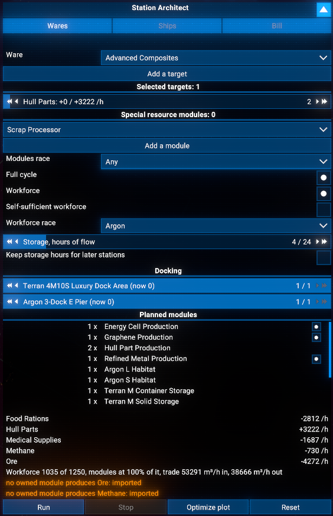

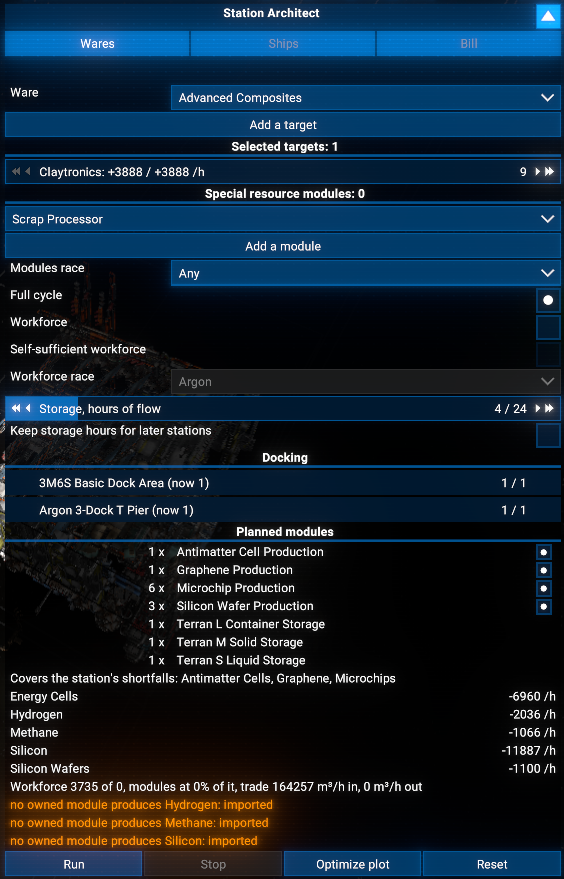

### Ships

Pick a build module from your blueprints, a fabrication bay or a maintenance bay, and press **Add a module**. Every build module kind the station has or you added gets a slider of its count, starting at what the station has; an added kind released at 0 is removed.

- Under a fabrication bay, one slider per ship size it builds sets the **ships per hour**, up to what those bays can build. It starts at that top, the bays' full capacity: lower it to the ships you expect to sell. An existing yard's bays start there too, so its first plan sizes docks and storage for full capacity. Sizes that share a bay share its time, so lowering one raises the other's top.
- Under a maintenance bay, one slider per ship size sets the **resupplies per hour** (restocking a ship's ammunition and units). It starts at a tenth of what the bays manage.
- **now** on a slider is what the station's bays are working on at the moment, per hour.

Ships are planned with the game's High loadout, which sets their build time and wares; a bay builds one ship per production line at a time. The plan adds the wares those ships and resupplies use, their production chain under **Full cycle**, and the storage and docks for that flow. The special resource modules, the options and the Docking sliders are the ones of the Wares tab.

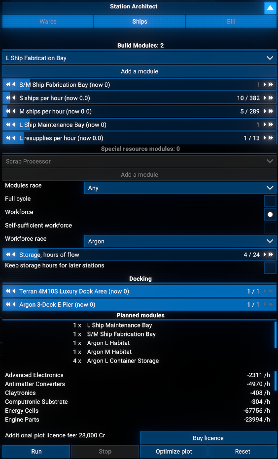

### Special resource modules

Both tabs have this section. It works with **Full cycle** only and is greyed out without it. Special resource modules (Scrap Processors) are fed by tugs rather than by trade. Pick one and press **Add a module**: its slider sets how many the station has, from its own count up to 10 more, and shows the module's output per hour; released at the station's count it is removed. On an existing station the section starts with the modules it has.

Their scrap metal feeds the scrap recycling modules that make your target wares and your ships' wares; only the rest comes from regular production modules, and a surplus is sold. Tugs bring the raw scrap straight to them, so it adds no docks, piers or storage.

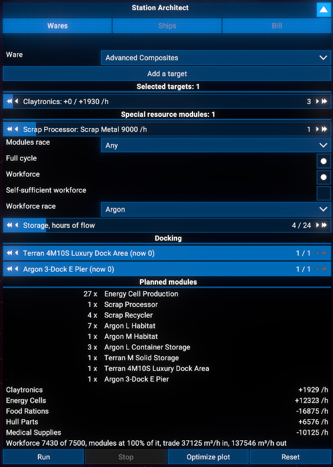

### Run

1. Press **Run**. The run first finds a layout. Where the plot costs money, it then shows the plot size it needs and the licence price, and places nothing until you press **Buy licence**; **Cancel** ends the run.

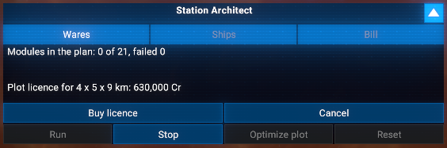

2. The run places the modules one after another, in turns from the bottom up: the station works after its first turn and every turn adds output, its storage and production chain from energy up, the final product last, then the dock areas and piers its trade needs. A new station opens its first turn with one pier and one dock area and grows from that pier; habitats and the modules that only feed them come after 40 % of the turns, spread evenly over the rest. The panel shows the progress and the turn, and **Stop** halts the run after the current module. Changing the plan by hand stops the run too, and closing the build menu ends it. The menu's lists are rebuilt once when the run ends, not after every module.

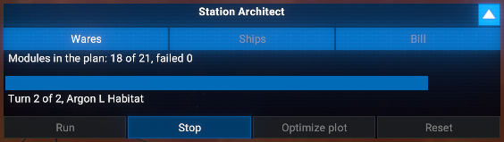

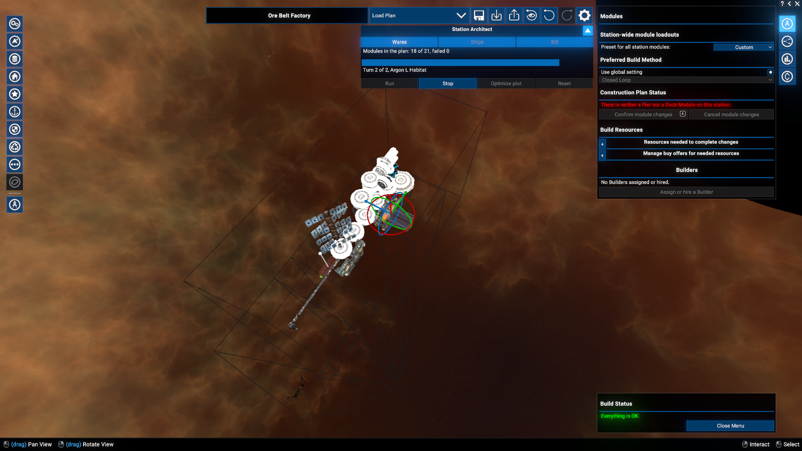

3. If the game's editor still refuses a module after a few retries, the run removes every module it placed and starts the placement over, once. A second refusal removes everything again, and the folded panel names the module.
4. When the run ends the panel folds to its result (placed, failed). Check the plan, change what you like by hand, and press **Confirm module changes** as usual. **Optimize plot** fits the plot to the planned modules, so a plot the run grew is not paid larger than needed. **Reset** starts the target over from what the station has. While a plot's licence is still due (a new plot before its run, or after a **Bill** run, which grows the plot without asking), the panel shows the fee with its own **Buy licence**.

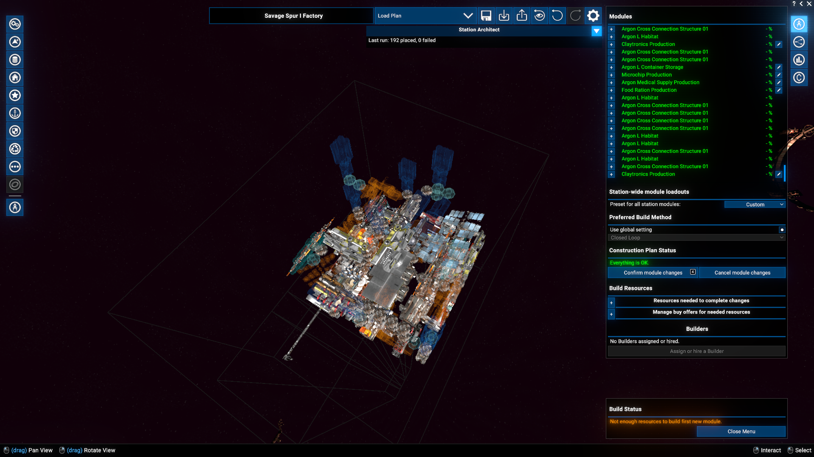

### From the map

Right-click empty space in a sector on the map and choose **Plan a station here**.

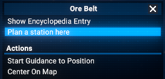

The dialog has the same **Wares** and **Ships** tabs, plus **Preset for all station modules** (the loadout of the new modules).

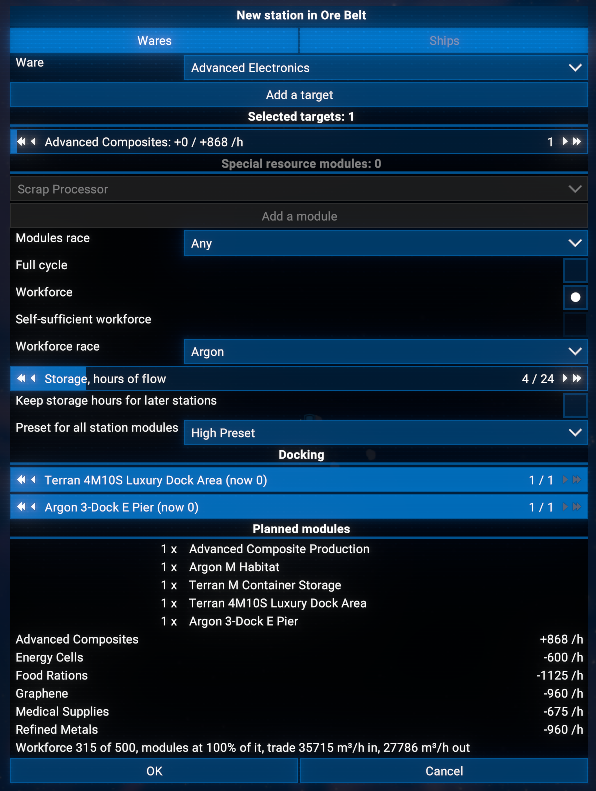

OK closes the dialog and puts the game's own plot box on your cursor, as the Plots tab's **Create plot** does: the box turns red where a plot may not go, and a left click reserves it. A right click or Escape before that click cancels the plan.

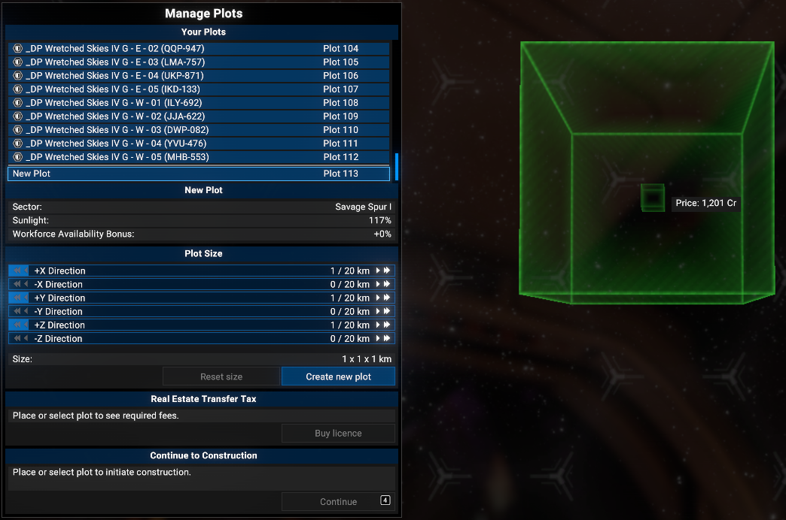

The build menu then opens and the run starts. The plot starts at 1 km and grows with the modules; **Confirm module changes** stays your click.

### Bill

The manual route: **Add** puts a row in the bill, with the category of the row above; pick its category and a module from your blueprints and type the count, 1 to 99. Repeat for every module type; a row's X removes it, **Clear** empties the bill.

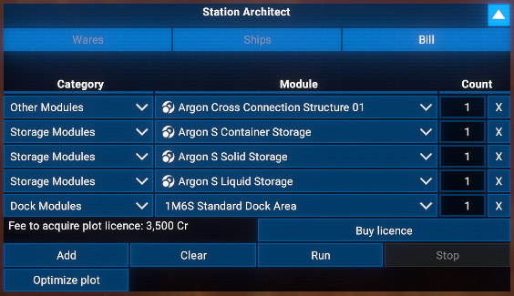

**Run** places the modules on the station's free connections, nearest to the centre first, docks, piers, build and defence modules on outward connections. Connection modules in the bill are not placed as such: they are the budget of connectors the run may insert when a module finds no free connection.

## Options

In the game's Extension Options, the Station Architect page has a Debug Level setting (None, Debug, Trace) for the game log.

## Videos

- [Intro video](https://www.youtube.com/watch?v=I0ORUjMGBjQ)
- [Star Wars Interworlds](https://www.youtube.com/watch?v=irCsdFh7BkQ)

## Credits

- Author: Chem O`Dun, on [Nexus Mods](https://next.nexusmods.com/profile/ChemODun/mods?gameId=2659) and [Steam Workshop](https://steamcommunity.com/id/chemodun/myworkshopfiles/?appid=392160)
- *"X4: Foundations"* is a trademark of [Egosoft](https://www.egosoft.com).

## Acknowledgements

- [EGOSOFT](https://www.egosoft.com) for the X series.
- [SirNukes](https://next.nexusmods.com/profile/sirnukes?gameId=2659) for the Mod Support APIs that power the UI hooks.

## Changelog

### [1.22] - 2026-11-??

- Added
  - Production modules for intermediate wares can be unticked in the planned modules; their ware is bought instead
  - **Keep storage hours for later stations** saves the storage hours for the next plans
- Changed
  - A station without connection structures is upgraded on the grid too: from its free connections, or beside it when they have no room
- Fixed
  - **Modules race** and **Workforce race** listed only the races you have met, so your modules of another race could not be picked
  - An upgrade beside a pier whose approach lanes point up refused its new docks as past the plot limit, and planned slowly
  - Planning could run on for hours when approach lanes covered all the space above the station

### [1.21] - 2026-11-09

- Added
  - Tested with Star Wars Interworlds and adapted to work with it
- Fixed
  - **Workforce race** and **Modules race** could start on a race you have not met, an empty choice in the list
  - Star Wars Interworlds habitats without a maker race could never be picked
  - A large workforce could plan a station-sized habitat of a total conversion and stall the run
  - When a layout was packed again on the 400 m cell, the panel folded to its title and showed no progress of that second pass
  - Modules whose body reaches back past the connection they hang by were built inside other modules
  - A cross too small for a module stacked those modules into a tower beside the station
  - A module was refused while the mouse cursor rested over the spot it was placed at

### [1.20] - 2026-11-08

- Added
  - **Ships** tab: build modules sized by ships per hour and resupplies per hour
  - **Docking** section: dock area and pier count sliders
  - A warning names a producer that will mostly idle
  - A ware made by several kinds of module is listed once per kind, as "Ware / Module"
- Changed
  - The Target tab is now the **Wares** tab, in the map dialog too
  - Modules are placed in turns from the bottom up: the station works from its first turn, a new station grows from its first pier, every turn ends with the docks its trade needs, habitats come in the later turns
  - Denser layouts on a finer grid, found faster; a layout the editor refuses is packed again on the coarse one
  - A module the editor refuses on touching faces is placed when nothing overlaps it; one it keeps refusing restarts the placement once, without slowing the rest of the run
  - Storage per ware: the smallest module size that holds it
  - Ship builds, their supply chain and build times follow the ships per hour and each hull's High loadout, not the bays' full capacity
  - Special resource modules only with **Full cycle**; their scrap metal feeds the ships' wares too
  - An existing station without a target gets the docks its own trade needs
  - Spare output of producers the station feeds itself counts as neither trade nor storage; a producer or habitat far above its need gives way to a smaller owned one
  - A ware target counts its kind of module, no longer modules of net output
  - The panel plans faster on large stations, and the progress line shows the turn on the grid layout too
- Fixed
  - Game 8.00: piers and dock areas never hung under a connection structure
  - Expanding the panel kept the earlier target instead of reading the station's plan again
  - Ware balance values cut off by the scroll bar
  - Very high-output modules (modded mining modules) feeding the production chain brought dozens of piers, dock areas and storages
  - An upgrade planned new habitats for workers the station's habitats had room for
  - Docks and piers with no room within the 20 km plot failed after everything else was placed
  - Connection structures could take the wrong race: an upgrade lost its grid layout, a new station followed its storages
  - A layout that fitted the plot's size but not its faces asked for a plot licence for a kilometre more

### [1.10] - 2026-10-30

- Added
  - **Special resource modules** on the Target tab: Scrap Processors whose scrap metal feeds the target wares
- Fixed
  - Raw scrap added docks, piers and storage to the plan

### [1.00] - 2026-10-28

- Added
  - Initial version
